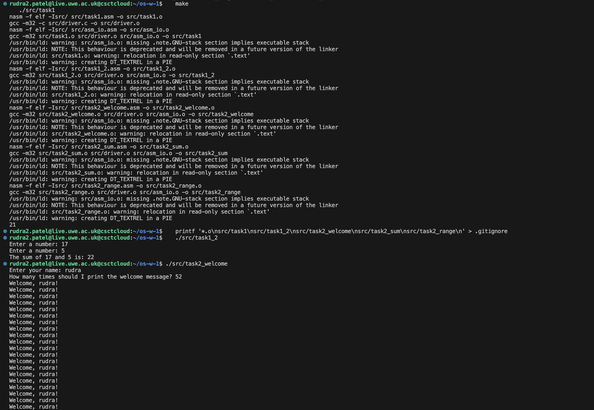
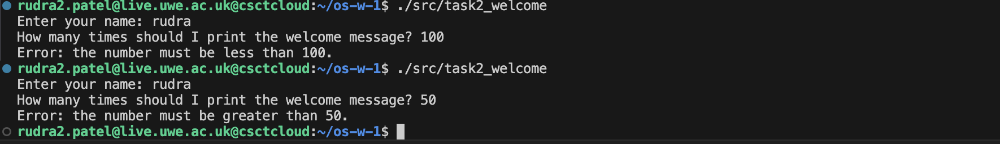
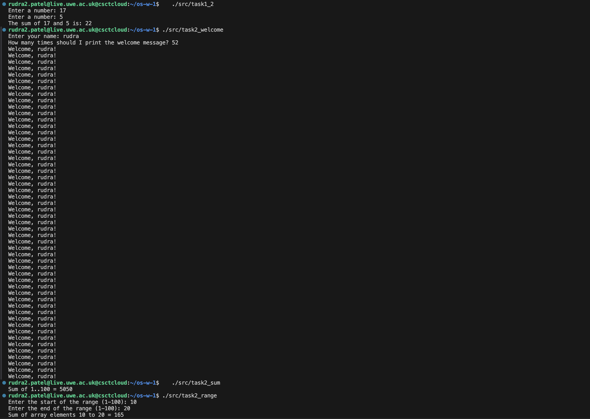
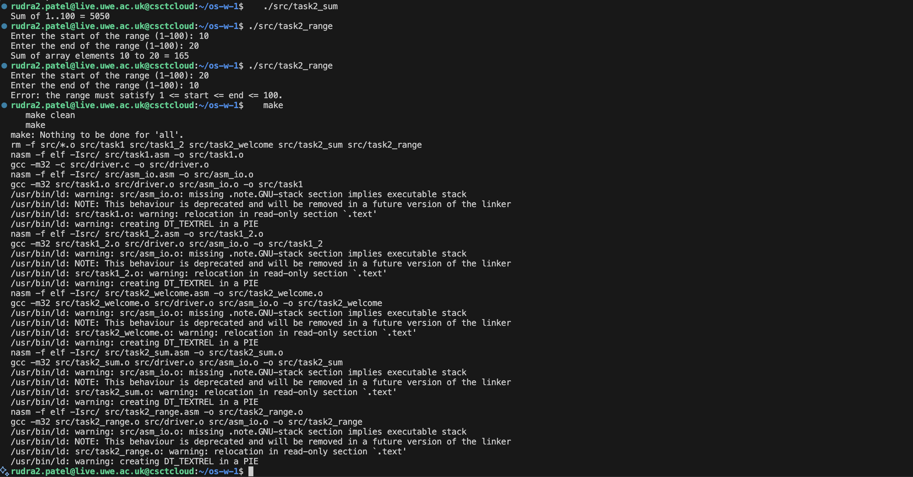

# UFCFWK-15-2 Operating Systems – Worksheet 1: An echo of Assembler

All programs are 32-bit x86 assembler (NASM syntax) built for Linux. Each assembler
file defines a function `asm_main`, which is called from a tiny C program
(`src/driver.c`). Input and output go through the helper routines in
`src/asm_io.asm` (`print_int`, `print_string`, `print_nl`, `read_int`, `read_char`).

## Repository layout

```
README.md
Makefile
src/
  asm_io.inc  asm_io.asm     I/O helper routines (provided)
  driver.c                   C main() that calls asm_main
  task1.asm                  Task 1  – add two globals
  task1_2.asm                Task 1  – read two integers, do arithmetic
  task2_welcome.asm          Task 2  – name + welcome message loop
  task2_sum.asm              Task 2  – sum of a 100-element array
  task2_range.asm            Task 2  – sum of a user-chosen range
```

## Building and running

```
make              # builds every program (default target "all")
make task1        # builds just one
make clean        # removes object files and executables
./src/task1
```

---

## Task 1 – First assembler programs

### How a program is put together

An assembler program is split into segments:

- `segment .data` – initialised globals (`dd` = a 4-byte value, `db` = bytes/strings)
- `segment .bss` – uninitialised globals (`resd 1` reserves one 4-byte value)
- `segment .text` – the code

`asm_main` is declared `global` so the linker can see it from `driver.c`. It follows
the C calling convention (cdecl): `enter 0, 0` / `leave` build and tear down the stack
frame, `pusha` / `popa` save and restore the registers, and the return value in `eax`
becomes the return value of `main`.

### `task1.asm` – add two integers held in global memory (slide 18)

The two integers live in the `.data` segment (initialised, so they use `dd`) and the
result goes in the `.bss` segment (uninitialised, so `resd 1` just reserves 4 bytes).

```nasm
segment .data
integer1    dd  15
integer2    dd  6

segment .bss
result      resd 1

        mov     eax, [integer1]     ; eax = int1      ([x] = the value stored at x)
        add     eax, [integer2]     ; eax = int1 + int2
        mov     [result], eax       ; result = int1 + int2
        call    print_int           ; print_int prints the value in eax
```

Square brackets mean "the contents of memory at this label"; without them `integer1`
would just be the address.

Build (the manual commands from the worksheet, which the Makefile in Task 3 automates):

```
nasm -f elf task1.asm -o task1.o
nasm -f elf asm_io.asm -o asm_io.o
gcc -m32 -c driver.c -o driver.o
gcc -m32 driver.o task1.o asm_io.o -o task1
```

Output:

```
$ ./task1
21
```



### `task1_2.asm` – read two integers and print their sum (slide 22)

This version gets its numbers from the keyboard. `read_int` returns the number in `eax`,
so it is copied straight into memory; `print_string` takes a *pointer* (address) in `eax`,
whereas `print_int` takes a *value*, which is why the code uses `mov eax, msg2` for one and
`mov eax, [integer1]` for the other.

```nasm
        mov     eax, msg1           ; a pointer to the string "Enter a number: "
        call    print_string
        call    read_int            ; the number typed by the user ends up in eax
        mov     [integer1], eax     ; store it in memory
        ...
        mov     eax, msg2           ; "The sum of "
        call    print_string
        mov     eax, [integer1]     ; a value this time, not an address
        call    print_int
```

```
$ ./task1_2
Enter a number: 17
Enter a number: 5
The sum of 17 and 5 is: 22
```


---

## Task 2 – Loops and conditionals

Assembler has no `if` or `for`. Both are built from a comparison (`cmp`) followed by a
conditional jump (`jl`, `jge`, `jle`, `jg`, `je`, `jnz`, …) that jumps to a label when
the condition holds.

### `task2_welcome.asm` – name, then a welcome message *n* times

1. Prompt for a name and read it one character at a time with `read_char` until a newline,
   storing the characters in a 64-byte buffer and ending it with a `0` byte. Extra
   characters beyond the buffer size are discarded so the buffer cannot overflow.
2. Prompt for a number with `read_int`.
3. Validate: the number must be **greater than 50 and less than 100** (so 51–99).
4. Print `Welcome, <name>!` that many times.

The validation is an `if / else if` chain:

```nasm
        cmp     ecx, 50
        jle     .too_small          ; n <= 50  -> error
        cmp     ecx, 100
        jge     .too_large          ; n >= 100 -> error
```

The loop counts `ecx` down to zero (the assembler equivalent of
`for (i = n; i != 0; i--)`):

```nasm
.loop_top:
        mov     eax, welcome1
        call    print_string
        mov     eax, user_name
        call    print_string
        ...
        dec     ecx                 ; i--  (sets the zero flag when it hits 0)
        jnz     .loop_top           ; repeat while i != 0
```

Runs:

```
$ printf 'Rd\n52\n' | ./src/task2_welcome
Enter your name: How many times should I print the welcome message? Welcome, Rd!
Welcome, Rd!
... (52 lines in total)

$ printf 'Rd\n50\n' | ./src/task2_welcome
Enter your name: How many times should I print the welcome message? Error: the number must be greater than 50.

$ printf 'Rd\n100\n' | ./src/task2_welcome
Enter your name: How many times should I print the welcome message? Error: the number must be less than 100.
```

I checked the boundaries: 51 and 99 print 51 and 99 messages; 50 and 100 give errors.





### `task2_sum.asm` – sum an array of 100 elements

The array is `array resd 100` (100 four-byte elements in `.bss`). Element *i* lives at
`array + i*4`, which x86 can express directly in one addressing mode:

```nasm
        xor     ecx, ecx                    ; i = 0
.init_loop:
        cmp     ecx, ARRAY_LEN
        jge     .init_done                  ; leave when i >= 100
        lea     eax, [ecx + 1]              ; eax = i + 1
        mov     [array + ecx*4], eax        ; array[i] = i + 1
        inc     ecx
        jmp     .init_loop
```

A second loop of the same shape does `add eax, [array + ecx*4]` to accumulate the sum.

```
$ ./src/task2_sum
Sum of 1..100 = 5050
```

5050 is the expected answer (100 × 101 / 2).



### `task2_range.asm` – sum a range chosen by the user

Extends the previous program: after filling the array it reads a start and an end value
(1-based and inclusive), checks that the range is valid, and sums just those elements.
The range is valid when `1 <= start <= end <= 100`, which needs three comparisons:

```nasm
        cmp     esi, 1
        jl      .invalid            ; start < 1
        cmp     edi, ARRAY_LEN
        jg      .invalid            ; end > 100
        cmp     esi, edi
        jg      .invalid            ; start > end
```

The array is 0-indexed but the user types 1-based numbers, so the loop starts at
index `start - 1` and runs while the index is less than `end`:

```nasm
        lea     ecx, [esi - 1]      ; i = start - 1
.sum_loop:
        cmp     ecx, edi            ; i < end ?
        jge     .sum_done
        add     eax, [array + ecx*4]
        inc     ecx
        jmp     .sum_loop
```

```
$ printf '10\n20\n' | ./src/task2_range
Enter the start of the range (1-100): Enter the end of the range (1-100): Sum of array elements 10 to 20 = 165

$ printf '1\n100\n' | ./src/task2_range
... Sum of array elements 1 to 100 = 5050

$ printf '20\n10\n' | ./src/task2_range
... Error: the range must satisfy 1 <= start <= end <= 100.
```

Also tested: `5 5` gives `5` (a single element), and `0 10` and `50 101` both give the error.


---

## Task 3 – Makefile

The `Makefile` in the repo root builds every program. It has three kinds of rule:

```make
# Link: program object + C driver + I/O library -> executable
$(TARGETS): $(SRC)/%: $(SRC)/%.o $(SRC)/driver.o $(SRC)/asm_io.o
	$(CC) $(CFLAGS) $^ -o $@

# Assemble: every .asm depends on asm_io.inc, which it %includes
$(SRC)/%.o: $(SRC)/%.asm $(SRC)/asm_io.inc
	$(NASM) $(ASMFLAGS) $< -o $@

# Compile the C driver
$(SRC)/driver.o: $(SRC)/driver.c
	$(CC) $(CFLAGS) -c $< -o $@
```

- The default rule `all` is listed first, so plain `make` builds all five programs.
- `$<` is the first prerequisite, `$@` the target and `$^` all the prerequisites. The `%`
  lets one rule cover every program.
- Because the object files are real targets with their own prerequisites, `make` only
  rebuilds what is out of date. After `touch src/task2_sum.asm`, `make` re-assembles and
  re-links only `task2_sum`; the other programs are left alone.
- `make clean` deletes the object files and executables (it is a `.PHONY` target as it
  does not create a file called `clean`).


---

## Task 4 – Documentation

This README documents the work: how each program works, code snippets for the key ideas,
and example runs. The complete source for every program is in the repository under
`src/`.
